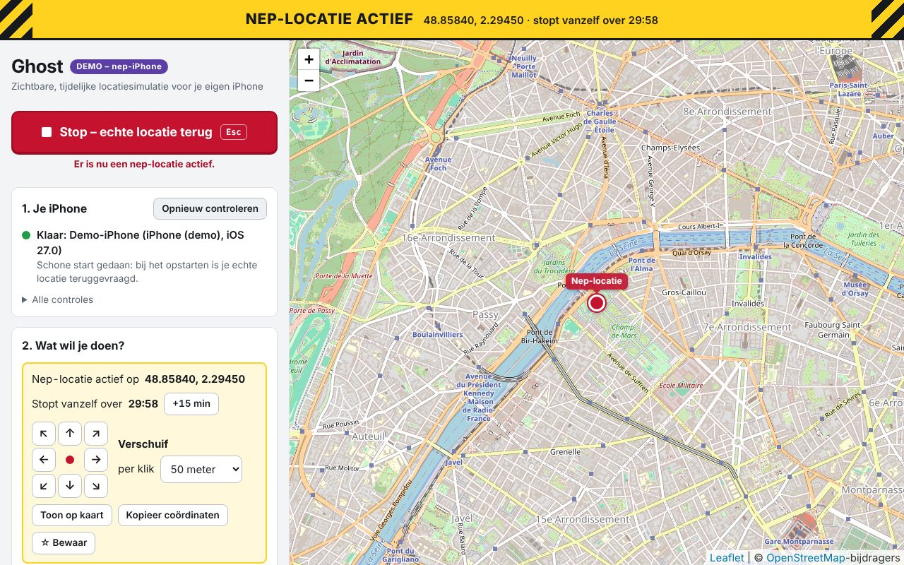

# Ghost

**A visible, temporary location simulator for your own iPhone — safety first.**

Ghost is a Windows app that replaces the GPS location of your own iPhone (connected by USB cable) with a simulated one. It uses Apple's own location simulation from Developer Mode, through the open-source library [pymobiledevice3](https://github.com/doronz88/pymobiledevice3). No jailbreak, no changes to iOS.

> **Status: work in progress.** From a page in your browser you can set a fixed location or let the location move along a route (walking, cycling or driving speed), nudge it with arrow buttons, save favourites and optionally search by address. There is always a stop button and an auto-stop timer. The heartbeat ("stop when I close the tab") and the recovery guide are still being built.



## What "safe" means here

Safe for **you**, the user:

- you can always see that a simulated location is active;
- Ghost always tries to put your real location back when you stop: on the stop button, the Esc key, the auto-stop timer, Ctrl+C, closing the window and after an unexpected error. It also does so every time it starts;
- if that fails (cable pulled), Ghost says so loudly and keeps trying;
- the web page only listens on your own computer (`127.0.0.1`) and refuses requests from other websites;
- your saved places and logs stay on your own computer.

"Safe" does **not** mean invisible. Ghost does nothing to hide the simulation from apps or anti-cheat systems, and it never will. That is also why routes move at a constant speed without artificial "human" noise.

## What leaves your computer

Ghost itself runs entirely on your computer. Only these requests go to the internet, and only when you trigger them:

| What | Where to | When |
| --- | --- | --- |
| Map images | `tile.openstreetmap.org` | While you look at the map. |
| A route along roads | `routing.openstreetmap.de` (FOSSGIS) | When you plan a route with "Volg de weg" on. The points you clicked are sent. Turn it off for a straight line. |
| An address search | `nominatim.openstreetmap.org` | Only after you switch on address search in the settings, and only when you click "Zoek". Off by default; see the [usage policy](https://operations.osmfoundation.org/policies/nominatim/). |

## Disclaimer

- Use it only on your own device.
- Developer Mode lowers the security of your iPhone. Turn it off when you are not using Ghost.
- Many apps and games (for example Pokémon GO) forbid location spoofing in their terms and may block accounts.

## Start

Requirements: Windows 64-bit, iTunes from [apple.com](https://www.apple.com/itunes/download/win64), [uv](https://docs.astral.sh/uv/), an iPhone with iOS 17.4 or later.

Double-click `start.bat`. Your browser opens at `http://127.0.0.1:8765`. Keep the black window open while you use Ghost.

No iPhone at hand? Double-click `start-demo.bat` to try the page with a fake iPhone.

Step-by-step instructions in Dutch: [docs/STARTEN.md](docs/STARTEN.md).

## For developers

```
uv sync
uv run pytest
uv run python -m ghost --demo web
uv run python -m ghost web
uv run python -m ghost status
```

How the pieces fit together:

| File | What it does |
| --- | --- |
| `ghost/device/` | Talks to the iPhone (`iphone.py`) or a fake one (`fake.py`). |
| `ghost/safety.py` | The safety manager: every location change goes through it, and it always clears on exit. |
| `ghost/exit_hooks.py` | Catches Ctrl+C and the console window being closed. |
| `ghost/controller.py` | Auto-stop timer, connection watchdog, routes and the state shown on the page. |
| `ghost/geo.py` | Pure route maths: distances, positions along a route. |
| `ghost/osm.py`, `ghost/net.py` | The two OpenStreetMap services (routing, address search), throttled to one request per second. |
| `ghost/store.py` | Favourites and settings, as JSON files in `%LOCALAPPDATA%\Ghost`. |
| `ghost/web/security.py` | Host check, Origin check and session token. No CORS. |
| `ghost/web/app.py` | The API the page talks to. |
| `ghost/web/server.py` | Start-up and shutdown order. |
| `ghost/web/static/` | The page itself. [Leaflet](https://leafletjs.com) 1.9.4 is included (BSD-2-Clause); map tiles come from [OpenStreetMap](https://www.openstreetmap.org/copyright). |

## Nederlandse samenvatting

Ghost zet tijdelijk een nep-locatie op je eigen iPhone, via Apple's eigen ontwikkelaarsfunctie. De app laat altijd zien dat de nep-locatie aan staat en probeert bij het stoppen altijd je echte locatie terug te zetten. Ghost is niet onzichtbaar voor apps en is daar ook niet voor bedoeld. De app is nog in ontwikkeling.

Starten: dubbelklik op `start.bat`. Het hele stappenplan staat in [docs/STARTEN.md](docs/STARTEN.md).

## License

GPL-3.0-or-later, see [LICENSE](LICENSE). Ghost uses pymobiledevice3, which is GPL-3.0-or-later.
