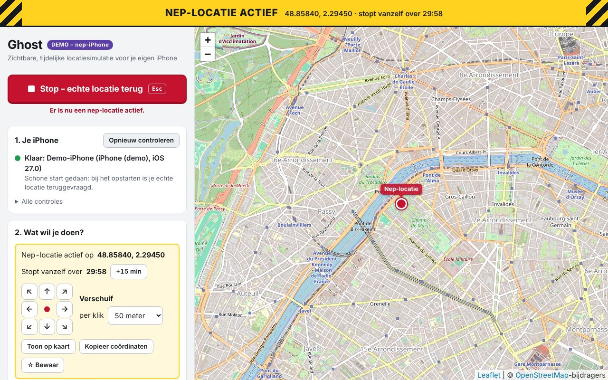
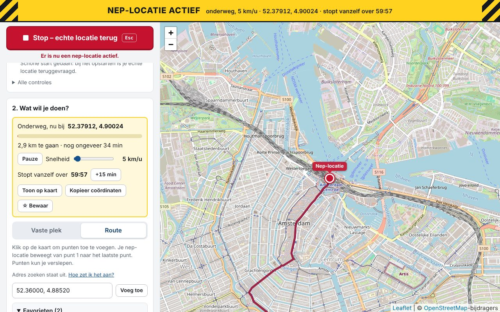

# Ghost starten: stappenplan

Dit is de gewone manier om Ghost te gebruiken: dubbelklikken, en dan alles in je browser.



## Wat je nodig hebt (eenmalig)

- Een Windows-laptop (64-bit).
- iTunes van de website van Apple: <https://www.apple.com/itunes/download/win64>
  (niet de versie uit de Microsoft Store).
- Het hulpprogramma `uv`: <https://docs.astral.sh/uv/>
- Een iPhone met iOS 17.4 of hoger en een USB-kabel die ook data doorgeeft.

Heb je de terminal-commando's (`status`, `set`, `clear`) al eens gebruikt? Dan heb je dit allemaal al.

## Stap 1: de nieuwste versie downloaden

1. Download de ZIP van GitHub (groene knop **Code** > **Download ZIP**).
2. Klik met rechts op de ZIP > **Alles uitpakken**.
3. Open de uitgepakte map. Je ziet daar onder andere `start.bat`.

Je oude map van Ghost mag je weggooien. Je logbestanden staan daar niet in; die staan in
`%LOCALAPPDATA%\Ghost`.

## Stap 2: dubbelklik op `start.bat`

Wat je hoort te zien:

1. Er opent een zwart venster. De **allereerste keer** in een nieuwe map duurt dit een paar
   minuten: dan worden de onderdelen gedownload. Daarna gaat het in een paar seconden.
2. In het zwarte venster staat `Ghost 0.1.0 draait.` en het adres `http://127.0.0.1:8765`.
3. Je browser opent vanzelf met de Ghost-pagina. Gebeurt dat niet, typ dan zelf
   `http://127.0.0.1:8765` in de adresbalk.

**Laat het zwarte venster open** zolang je Ghost gebruikt. Dat venster ís Ghost; de pagina in
je browser is alleen de bediening.

> Krijg je een blauwe waarschuwing "Windows heeft uw pc beschermd"? Dat komt doordat het bestand
> van internet komt. Klik op **Meer informatie** en dan op **Toch uitvoeren**. Wil je eerst zien
> wat `start.bat` doet: klik er met rechts op > **Bewerken**. Het is leesbare tekst met uitleg.

Alleen even rondkijken zonder iPhone? Dubbelklik dan op `start-demo.bat`. Die gebruikt een
nep-iPhone; er gebeurt niets met een echt toestel.

## Stap 3: je iPhone aansluiten

Sluit je iPhone aan met de kabel en ontgrendel hem. Kijk in de pagina bij **1. Je iPhone**:

- **Groene stip en "Klaar: ..."**: alles is in orde. Ghost heeft dan ook meteen je echte locatie
  teruggevraagd (de "schone start").
- **Geel vak met een probleem**: lees de stappen in het vak. Waar het kan, staat er een knop bij
  (bijvoorbeeld "Koppel de iPhone"). Ghost controleert elke paar seconden vanzelf opnieuw, dus
  het vak verdwijnt zodra het is opgelost.

## Stap 4: een nep-locatie zetten

Bij **2. Wat wil je doen?** kies je een van de twee tabbladen.

### Vaste plek: je iPhone staat op één plek

1. Klik op de kaart op de plek die je wilt. Of plak coördinaten in het tekstvak
   (bijvoorbeeld `48.8584, 2.2945`) en klik op **Toon op kaart**.
2. Kies bij **Stop vanzelf na** hoe lang het mag duren (standaard 30 minuten).
3. Klik op **Zet nep-locatie hier**.

Wat je hoort te zien: bovenaan een gele balk **NEP-LOCATIE ACTIEF** met de coördinaten en een
aftellende timer, en een rode stip "Nep-locatie" op de kaart. Controleer het in Apple Kaarten op
je iPhone.

In het gele blok in de zijbalk kun je daarna:

- met de **pijltjes** de nep-locatie een stukje verschuiven (10, 50, 100 of 500 meter per klik);
- de timer verlengen met **+15 min**;
- de plek bewaren als favoriet met **☆ Bewaar**, of de coördinaten kopiëren.

Een heel andere plek? Klik op de kaart en dan op **Verplaats nep-locatie hierheen**.

### Route: je nep-locatie beweegt



1. Klik op het tabblad **Route**.
2. Klik op de kaart voor het beginpunt, en daarna voor elk volgend punt (hooguit 25).
   Een punt verkeerd gezet? Sleep het naar de goede plek, of klik op het kruisje in de lijst.
3. Kies **Lopen**, **Fietsen** of **Auto**. De snelheid past zich aan (5, 15 of 40 km/u);
   met de schuif kies je zelf iets tussen 1 en 120 km/u.
4. Kies eventueel **Heen en terug** of **Blijf herhalen**.
5. Kijk naar de samenvatting (afstand en tijd) en kies een timer die lang genoeg is.
6. Klik op **Start route**.

Wat je hoort te zien: de rode stip beweegt over de rode lijn, en in het gele blok loopt een
voortgangsbalk. Daar zitten ook **Pauze** en de schuif om onderweg de snelheid te veranderen.
Aan het eind blijft de nep-locatie op het eindpunt staan tot de timer afloopt of je stopt.

**Volg de weg** staat standaard aan. Ghost vraagt de route dan op bij `routing.openstreetmap.de`,
een gratis dienst van de vereniging FOSSGIS. De punten die je aanklikt gaan daarvoor naar die
dienst. Wil je dat niet, zet het vinkje dan uit: Ghost rekent dan zelf een rechte lijn uit en er
gaat niets naar internet (behalve de kaartplaatjes).

### Favorieten

Onder **Favorieten** staan de plekken die je hebt bewaard. Klik op een favoriet om hem te kiezen;
op het tabblad Route wordt het dan een volgend punt van je route. Favorieten staan alleen op je
eigen laptop, in `%LOCALAPPDATA%\Ghost\favorieten.json`.

### Adres zoeken (staat standaard uit)

Wil je op adres of plaatsnaam zoeken? Open onderaan **Instellingen** en zet **Adres zoeken
aanzetten** aan. Lees eerst wat erbij staat: je zoektekst gaat dan naar
`nominatim.openstreetmap.org`, een gratis dienst met regels
([gebruiksbeleid](https://operations.osmfoundation.org/policies/nominatim/)). Ghost zoekt alleen
als je zelf op **Zoek** klikt, hooguit één keer per seconde, en onthoudt wat je al gezocht hebt.
Zonder deze instelling kun je altijd coördinaten plakken, bijvoorbeeld uit Google Maps
(rechtsklik op een plek > klik op de coördinaten om ze te kopiëren).

## Stap 5: stoppen

- **Rode knop "Stop – echte locatie terug"**, of de toets **Esc**. Dit mag altijd, ook als je twijfelt.
- De timer doet hetzelfde als de tijd om is.
- Klaar met Ghost? Klik onderaan op **Ghost afsluiten**. Ghost vraagt dan eerst je echte locatie
  terug en stopt daarna. Het zwarte venster kun je dan sluiten.

Controleer na het stoppen altijd in Apple Kaarten of je echte locatie weer klopt. De iPhone laat
Ghost namelijk nooit weten of dat gelukt is; Ghost weet alleen dat het verzoek is aangekomen.

Gebruik je Ghost een tijd niet? Zet dan Developer Mode uit op je iPhone:
Instellingen > Privacy en beveiliging > Developer Mode.

## De vangnetten

Uit een test met een echte iPhone weten we: een nep-locatie blijft staan als Ghost stopt zonder
op te ruimen. Daarom ruimt Ghost zelf op, op al deze momenten:

| Wat er gebeurt | Wat Ghost doet |
| --- | --- |
| Ghost start | Vraagt eerst je echte locatie terug (schone start). |
| Rode knop of Esc | Vraagt je echte locatie terug. |
| De timer loopt af | Vraagt je echte locatie terug. Dat geldt ook midden in een route. |
| Een punt van een route komt niet aan | Stopt de route en vraagt je echte locatie terug. |
| Knop "Ghost afsluiten" | Vraagt je echte locatie terug en stopt dan. |
| Ctrl+C in het zwarte venster | Vraagt je echte locatie terug en stopt dan. |
| Je sluit het zwarte venster met het kruisje | Vraagt je echte locatie terug in de paar seconden die Windows geeft. |
| Er gaat iets onverwachts mis in Ghost | Vraagt je echte locatie terug. |
| De kabel gaat eruit terwijl er iets actief is | Rode balk "VERBINDING MET DE IPHONE WEG". Zodra de kabel er weer in zit, vraagt Ghost vanzelf je echte locatie terug. |
| Ghost was de vorige keer niet netjes afgesloten | Onthoudt dat, en vraagt bij de volgende start meteen je echte locatie terug. |

## Wat Ghost niet kan opvangen

- De stroom valt uit, de accu is leeg, of je stopt Ghost via Taakbeheer.
- Je sluit het tabblad in de browser. De nep-locatie blijft dan staan tot de timer afloopt of
  je Ghost afsluit. (Een optie "tabblad dicht = stoppen" komt later.)

In die gevallen: sluit je iPhone aan en start Ghost opnieuw. De schone start zet het recht.

## Als het niet werkt

| Wat je ziet | Wat je doet |
| --- | --- |
| Het zwarte venster zegt dat `uv` niet gevonden is | Volg de stappen in het venster. Werkt `uv` wel in PowerShell? Herstart dan je laptop. |
| "Ghost draait al" | Er staat nog een zwart venster van Ghost open. Gebruik dat, of sluit het eerst. |
| "Poort 8765 is al in gebruik door een ander programma" | Open PowerShell in de map van Ghost en plak: `uv run python -m ghost web --port 8766` |
| De pagina zegt "Geen contact met Ghost" | Het zwarte venster is gesloten. Dubbelklik opnieuw op `start.bat`. |
| De kaart blijft grijs | Je hebt geen internet, of de kaartserver van OpenStreetMap is even niet bereikbaar. Coördinaten plakken werkt wel. |
| "De routeserver is niet bereikbaar" | Je hebt geen internet, of de gratis routeserver is druk. Zet **Volg de weg** uit voor een rechte lijn, of probeer het later. |
| "Tussen deze punten is geen route over de weg gevonden" | Een punt ligt bijvoorbeeld op zee. Verplaats het punt, of zet **Volg de weg** uit. |
| "De zoekdienst weigert op dit moment verzoeken" | De gratis zoekdienst is druk of blokkeert tijdelijk. Wacht een paar minuten, of plak coördinaten. |
| Na Ctrl+C vraagt het venster "Batchtaak beëindigen (J/N)?" | Dat is Windows, niet Ghost. Beide antwoorden zijn goed. |

Technische details van fouten staan in het logbestand. Het pad staat onderaan de pagina
(`%LOCALAPPDATA%\Ghost\logs\ghost.log`). Coördinaten staan daar afgerond in (ongeveer 1 km).

## Voor ontwikkelaars

```
uv sync                                  # onderdelen installeren
uv run pytest                            # alle tests
uv run python -m ghost web               # hetzelfde als start.bat
uv run python -m ghost --demo web        # met een nep-iPhone
uv run python -m ghost web --no-browser  # zonder de browser te openen
uv run python -m ghost --debug web       # alles loggen, inclusief exacte coördinaten
```

De losse commando's `status`, `pair`, `set` en `clear` bestaan nog steeds.
